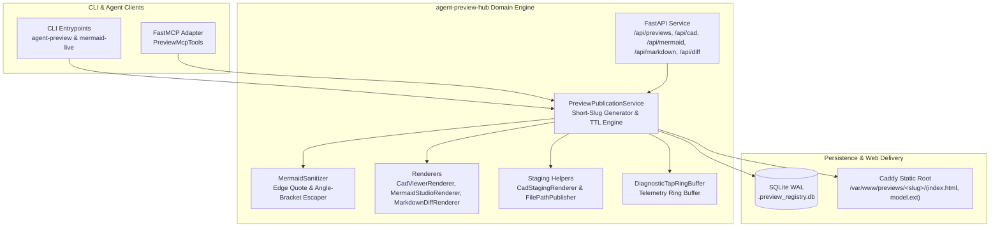
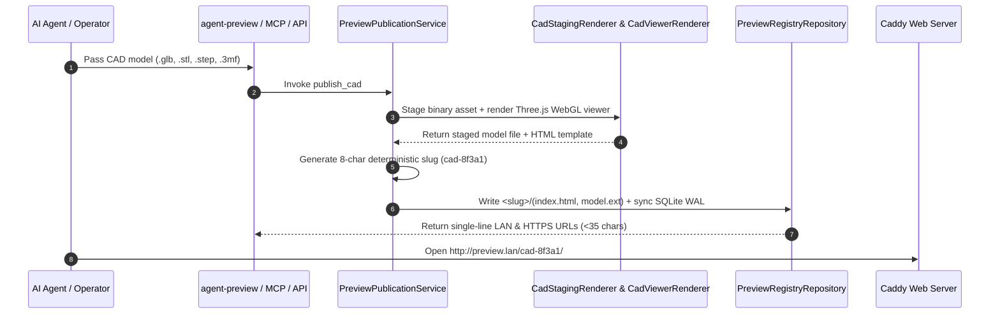

# Agent Preview Hub Architecture

`agent-preview-hub` provides a self-hosted preview server, interactive Mermaid Studio, and rich Markdown and diff renderer for autonomous AI agents.

---

## System Topology

The system follows the **APIs First, MCP Later** principle. Core domain services handle sanitization, rendering, SQLite WAL persistence, and short-slug generation before exposing HTTP, CLI, and FastMCP interfaces.

---

## Publication Sequence

---

## Module Boundaries

- **`models.py`**: Defines Pydantic v2 schemas (`CadPublishRequest`, `CadMetadata`), `PreviewRecord`, and `AgentFeedbackEnvelope`.
- **`cad_staging_renderer.py`**: Validates CAD formats (`.glb`, `.stl`, `.step`, `.stp`, `.3mf`), safely stages binary assets, and coordinates rendering.
- **`cad_viewer_renderer.py`**: Generates full Three.js WebGL interactive viewer HTML with turntable orbit controls, wireframe toggle, camera presets, and bounding box extents.
- **`database.py`**: Implements `PreviewRegistryRepository` using SQLite in `WAL` mode synchronized with `previews.json`.
- **`slug_generator.py`**: Generates collision-checked deterministic short slugs (`m-<5hex>`, `cad-<5hex>`, `md-<5hex>`, `df-<5hex>`).
- **`file_path_publisher.py`**: Stages file system paths, directories, and assets with media wrappers.
- **`mermaid_sanitizer.py`**: Quotes edge labels, converts literal `\n` inside node labels to ` `, and escapes `<placeholder>` tags.
- **`mermaid_studio_renderer.py`**: Renders an interactive pan-and-zoom SVG canvas and split-pane live code editor using `mermaid.render()`.
- **`markdown_diff_renderer.py`**: Renders GitHub-Flavored Markdown, tables, alerts, unified diffs, and embedded Mermaid diagrams.
- **`publication_service.py`**: Orchestrates preview lifecycle, storage, and retention under `< 500 LOC`.
- **`api.py`**: Exposes FastAPI HTTP endpoints for multipart CAD uploads (`/api/cad/upload`), JSON payloads, preview management, and health probes.
- **`mcp_server.py`**: Wraps `PreviewPublicationService` with FastMCP tools including `publish_cad_preview`.
- **`cli.py`**: Provides the `agent-preview` (`cad`, `publish`, `text`, `mermaid`, `md`, `diff`, `port`) and `mermaid-live` commands.
