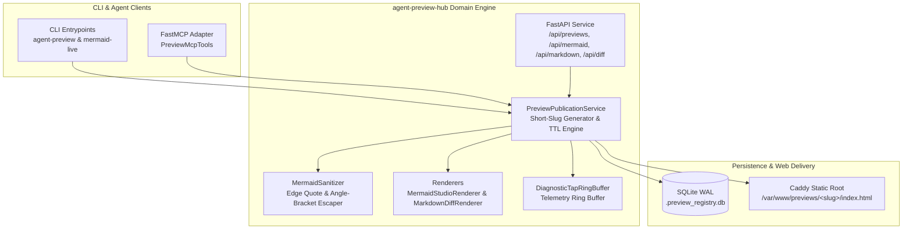
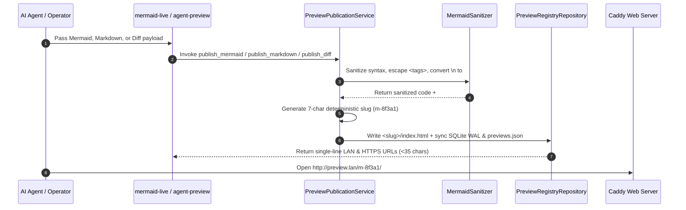

# Agent Preview Hub Architecture

`agent-preview-hub` provides a self-hosted preview server, interactive Mermaid Studio, and rich Markdown and diff renderer for autonomous AI agents.

---

## System Topology

The system follows the **APIs First, MCP Later** principle. Core domain services handle sanitization, rendering, SQLite WAL persistence, and short-slug generation before exposing HTTP, CLI, and FastMCP interfaces.

---

## Publication Sequence

---

## Module Boundaries

- **`models.py`**: Defines Pydantic v2 request schemas, `PreviewRecord`, and `AgentFeedbackEnvelope`.
- **`database.py`**: Implements `PreviewRegistryRepository` using SQLite in `WAL` mode synchronized with `previews.json`.
- **`mermaid_sanitizer.py`**: Quotes edge labels, converts literal `\n` inside node labels to ` `, and escapes `<placeholder>` tags.
- **`mermaid_studio_renderer.py`**: Renders an interactive pan-and-zoom SVG canvas and split-pane live code editor using `mermaid.render()`.
- **`markdown_diff_renderer.py`**: Renders GitHub-Flavored Markdown, tables, alerts, unified diffs, and embedded Mermaid diagrams.
- **`publication_service.py`**: Generates deterministic short slugs (`m-<5hex>`) so terminal URLs never wrap across lines.
- **`api.py`**: Exposes FastAPI HTTP endpoints for preview management and health probes.
- **`mcp_server.py`**: Wraps `PreviewPublicationService` for Model Context Protocol clients.
- **`cli.py`**: Provides the `agent-preview` and `mermaid-live` CLI commands.
